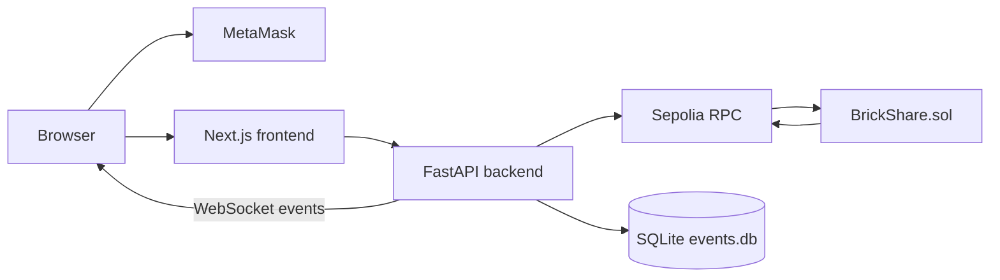

# BrickShare — Technical Design

## Status

This document describes the implementation in this repository. The deployed contract is verified on Ethereum Sepolia at [0x8c868c908EEA15Be89ef7f092da85bc0739Cd1e0](https://sepolia.etherscan.io/address/0x8c868c908EEA15Be89ef7f092da85bc0739Cd1e0), deployment block `12068071`.

## Architecture



MetaMask signs all state-changing transactions. The backend uses a read-only RPC provider and never holds a blockchain private key.

## Stack

- Solidity `0.8.24` with OpenZeppelin contracts.
- Python, FastAPI, web3.py, SQLite and Uvicorn.
- Next.js `16.4.5`, React `19.3.0`, TypeScript, ethers.js `6.17.0` and GSAP.
- Ethereum Sepolia, chain ID `11155111`.

## Contract and extension

`BrickShare.sol` stores the fixed share price, cap, sale state, document CID and two immutable admin addresses. The chosen assignment extension is two-admin investor approval:

1. Admin A or Admin B calls `approveInvestor(address)`.
2. Each admin can approve an address only once.
3. The investor becomes verified after both different admins approve.
4. `buy()` requires verification and exact ETH payment.

The owner can set the document CID, pause the sale and withdraw contract ETH. The source contract does not implement wallet sign-in, Pinata upload, or document approval/sign-off; those are not presented as implemented features.

## Backend API

| Method | Path | Purpose |
|---|---|---|
| GET | `/health` | Sepolia and deployed bytecode health check |
| GET | `/property` | Real contract metadata, supply, price, sale and document CID |
| GET | `/demo/role/{address}` | Read-only role detection from deployed contract state |
| GET | `/holdings/{address}` | Real balance, ownership, approvals and purchase ability |
| GET | `/investors/{address}/status` | Verification and admin approval status |
| GET | `/events?limit=50` | Indexed event history; refresh first catches up missed blocks |
| WS | `/ws/events` | Live event messages after SQLite insertion |

The event listener monitors `InvestorApproved`, `InvestorVerified`, `TokensPurchased`, `DocumentUpdated`, `SaleStatusChanged` and `Withdrawn`. Events are keyed by transaction hash and log index, stored in SQLite, and recovered from the saved block checkpoint. RPC log requests use ten-block windows because the configured provider rejects larger windows.

## Frontend

Routes are `/`, `/holdings`, `/admin` and `/owner`. The frontend handles MetaMask absence, account changes, chain changes, Sepolia switching, role detection, read-only demo lookup, transaction feedback, live events and public IPFS gateway links for a recorded CID.

## Custody and security

- Owner, Admin A, Admin B and investor keys remain in separate test-wallet MetaMask accounts.
- The backend has no private key and cannot submit contract transactions.
- Real RPC credentials remain in ignored `backend/.env`; placeholders are in `backend/.env.example` and `frontend/.env.example`.
- Contract authorization is the security boundary. Frontend role checks only control presentation.
- Public IPFS documents are not proof of legal title or valuation.

## Testing

Safe checks:

```powershell
cd backend
venv\Scripts\python.exe -m py_compile main.py
venv\Scripts\python.exe -m unittest test_main.py

cd ..\frontend
npm run lint
npx tsc --noEmit
npx next build --webpack
```

The backend unit suite covers address validation, duplicate event storage, role priority including a verified zero-balance wallet, and refresh-triggered event indexing. Live Sepolia health, property, role and event endpoints were also exercised during development. Manual MetaMask flows remain manual verification.

## Known limitations

- SQLite and the event WebSocket are designed for one local backend process.
- The configured RPC provider limits log query ranges, so recovery is intentionally incremental.
- IPFS upload is outside this implementation; the owner records an existing CID through `setDocument`.
- The project is a Sepolia demonstration and does not represent legal property title or real-world valuation.

## Acknowledgements

OpenZeppelin, FastAPI, web3.py, Next.js, React, ethers.js, GSAP and AI-assisted development were used. The author must be able to explain the submitted code.
